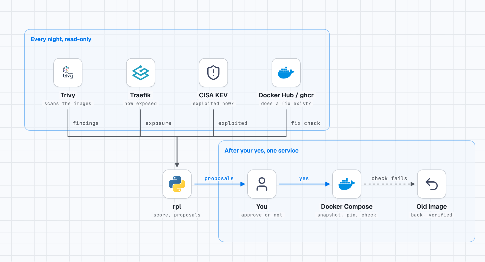

# risk-patch-loop

[](https://github.com/renocz/risk-patch-loop/actions/workflows/tests.yml)

[English](README.md) · **Français**

**Quelles vulnérabilités de conteneurs comptent vraiment sur *votre* hôte, existe-t-il un correctif qui les supprime réellement, et peut-on l'appliquer sans risque, avec un humain qui dit oui ?**

En une minute :
- Un scanner vous donne une liste. Sur le homelab de l'auteur, un scan de nuit a renvoyé 2 297 constats HIGH/CRITICAL corrigeables. Ce n'est pas une liste de tâches.
- rpl les classe selon l'exposition réelle de chaque conteneur, vérifie qu'une image plus récente supprime bien le constat (scannée depuis le registre, rien n'est téléchargé) et prépare des propositions.
- En appliquer une est une commande séparée qui ne touche qu'**un service à la fois** : instantané, sauvegarde de base de données, image épinglée, essai à blanc, recréation, contrôle de santé et d'une route, et un retour arrière automatique vérifié si le contrôle échoue.
- Rien ne se passe sans un humain : l'outil prépare, vous décidez.

C'est une preuve de concept construite et utilisée pendant une semaine sur un hôte Docker, dont les limites sont [écrites, pas cachées](#limites-connues). Elle s'adresse à qui accepte de lire 1 000 lignes de Python, pas à un produit.

## La boucle en une image

Chaque nuit, en lecture seule : rpl lit quatre choses qu'un scanner seul ne combine pas. Après votre oui, un service est mis à jour, et si le contrôle échoue l'ancienne image revient.

<picture>
  <source media="(prefers-color-scheme: dark)" srcset="docs/loop-dark.png">
  
</picture>

```
scan ──► inventaire ──► score de risque ──► vérif. du correctif ──► propositions ──► vous dites oui ──► patch + retour arrière automatique
```

- **Score selon l'exposition.** Gravité, « exploité dans la nature » (CISA KEV), accès au socket Docker et rôle du service, le tout pondéré par l'accessibilité du conteneur : Internet sans authentification, derrière une authentification, port du réseau local, localhost seul, interne.
- **Un correctif est prouvé avant d'être proposé.** La version candidate est scannée *depuis le registre* (rien n'est téléchargé). Si le mainteneur n'a pas publié d'image reconstruite, la réponse est « pas de correctif », pas un changement de tag qui ne change rien.
- **Un service à la fois.** Instantané, sauvegarde de base de données, image épinglée, essai à blanc, recréation, contrôle de santé et d'une route, retour arrière automatique si le contrôle échoue. Un conteneur VPN et les services derrière lui sont refusés.
- **Rien ne se passe sans un humain.** L'outil prépare des propositions ; en appliquer une est une commande séparée et explicite.

## Par où commencer

- **J'ai Docker Compose derrière Traefik et je veux l'essayer :** le [démarrage rapide](#démarrage-rapide), puis les [fichiers à écrire à la main](#fichiers-à-écrire-à-la-main-voir-examples).
- **Je veux savoir à quoi me fier :** les [limites connues](#limites-connues), puis [docs/results.md](docs/results.md) (en anglais) : ce qui a été mesuré, ce qui ne l'a pas été, et les défauts de l'outil à sa première utilisation sur un vrai hôte.
- **Je veux voir comment il décide :** [docs/design.md](docs/design.md) (en anglais : la boucle, les décisions, les limites).
- **Un agent IA pilote mon infrastructure :** donnez-lui les étapes en lecture seule et gardez `--apply` derrière une approbation qu'il ne peut pas s'accorder lui-même, voir [Avec un agent IA](#avec-un-agent-ia).

## État : v0.9, un hôte, des chiffres honnêtes

Construit et utilisé pendant une semaine sur un hôte Docker (65 conteneurs, Traefik, un propriétaire). **Lisez [docs/results.md](docs/results.md) avant de lui faire confiance** (en anglais) : le score est d'accord avec les verdicts de son propriétaire 14 fois sur 20 (une réponse triviale « toujours différer » en obtient 13), les rôles ont été réglés après avoir vu ces verdicts, et le retour arrière automatique n'a jamais été déclenché sur un vrai service. Il gère Docker Compose + Traefik, Docker Hub et ghcr.io.

Testé : 203 tests automatiques contre un faux hôte Docker (enchaînement et refus), lancés en CI sur Python 3.9 et 3.12 ; quelques comportements ont aussi été vérifiés à la main sur un vrai Docker (voir les limites ci-dessous).

## Limites connues

Reprises de [docs/results.md](docs/results.md) (en anglais) ; aucune n'est cachée, aucune n'est encore corrigée.

- **Un seul hôte.** Tout a été mesuré sur un homelab (65 conteneurs, un propriétaire, une semaine). Aucun deuxième hôte ne l'a fait tourner.
- **Traefik seulement.** L'exposition vient des labels Traefik. Un autre reverse proxy, ou des routes définies dans un fichier, seront lus comme « non routé ».
- **Docker Hub et ghcr.io seulement.** Tout autre registre donne « UNKNOWN », jamais une supposition.
- **Le retour arrière automatique n'a jamais été déclenché sur un vrai service.** Il a été exercé trois fois volontairement (2 novembre 2026) sur un service jetable d'un vrai hôte Docker : une nouvelle image qui ne sert rien, une qui ne devient jamais saine, et un `docker compose up` dont le nouveau conteneur ne peut pas démarrer. À chaque fois l'ancienne image est revenue (même identifiant), la route a de nouveau répondu, le fichier compose a été restauré et le journal indiquait `rollback ok`. Cela ne prouve ni une vraie application, ni un vrai conflit de port, ni le critère 1.0 de trois retours arrière sur un vrai hôte. À considérer comme testé, pas comme prouvé.
- **Les tests automatiques n'exécutent ni vrai Docker, ni Compose, ni Trivy, ni registre réel.** Ils prouvent l'enchaînement et les refus contre un faux hôte. Quelques comportements ont été vérifiés à la main, une fois, sur Docker 29.9.2 et Compose v5.6.1 (voir [docs/results.md](docs/results.md)) ; les autres versions ne sont pas couvertes et la CI ne répète pas ces vérifications.
- **Le score est un classement, pas un verdict.** Il est d'accord avec son propriétaire 14 fois sur 20 (la réponse triviale « toujours différer » : 13), sur vingt cas, avec des rôles choisis après avoir vu les verdicts. Aucun taux de faux négatifs n'a été mesuré.
- **Une mise à jour en bonne santé mais cassée passe.** Le contrôle prouve que le conteneur est sain, qu'il exécute la nouvelle image et qu'une route répond ; il ne prouve pas que l'application fonctionne.
- **Le retour arrière rétablit l'image, pas les données.** Une migration de base exécutée par la nouvelle version n'est pas annulée ; seules la sauvegarde ou l'instantané le peuvent.
- **Les images tirées ne sont pas vérifiées.** L'outil fait confiance au tag et au registre : pas de vérification de signature (cosign ou équivalent), et pour un tag mobile seul le digest que le registre indique à ce moment est épinglé. Un registre ou un mainteneur compromis échappe à ce qu'il peut détecter.
- **Les conteneurs VPN sont reconnus par leur nom** (« gluetun »), pas par ce qu'ils font.

## Feuille de route vers la 1.0

La 1.0 sort quand les trois conditions sont remplies, chacune avec ses preuves dans `docs/results.md`. Les chiffres sont des cibles proposées, discutables dans une issue.

1. **Retour arrière exercé en conditions réelles.** Au moins 3 retours arrière automatiques sur un vrai hôte, couvrant un conteneur qui ne devient jamais sain, une route qui répond un statut inattendu, et un `docker compose up` qui échoue ; chacun journalisé `rollback ok`, avec l'ancienne image en service et sa route qui répond ensuite. Journaux publiés.
2. **Un deuxième hôte.** Au moins 4 semaines consécutives sur un second hôte indépendant (autre propriétaire, ou reverse proxy autre que Traefik) avec 20 conteneurs ou plus, présentées dans le même format que les chiffres du premier hôte.
3. **Un taux de faux négatifs mesuré.** Un échantillon étiqueté d'au moins 100 constats, avec les verdicts d'au moins 2 relecteurs, tiré après gel des rôles et des seuils (pas les 20 cas ayant servi au réglage). Publier combien de verdicts « agir » le score classe sous ACT, avec un intervalle de confiance. Cible : au plus 10 % des verdicts « agir » manqués. Si la cible n'est pas atteinte, le score change et la mesure est refaite avant la 1.0.
   - *Vérité terrain :* un constat « méritait ACT » quand au moins 2 relecteurs répondent « agir » indépendamment, sur des critères écrits **avant** l'étiquetage : exploitable depuis l'endroit où le conteneur est exposé (niveau d'exposition de l'inventaire, pas deviné), un correctif existe, et le composant vulnérable est atteignable dans ce service. Les désaccords sont tranchés par un troisième relecteur et rapportés, pas cachés. Les relecteurs ne voient pas le score.
   - *Dénominateur :* les verdicts « agir » de cet échantillon étiqueté, tiré au hasard (graine fixée et publiée) parmi tous les constats des scans d'au moins 2 hôtes, stratifié pour que les constats classés WATCH ou PLAN par le score soient aussi nombreux que ceux classés ACT ; le taux est « verdicts agir classés sous ACT » / « verdicts agir », les deux nombres affichés, pas seulement le pourcentage.

## Démarrage rapide

Python 3.9 ou plus, aucune dépendance. Docker avec le plugin Compose ; Trivy tourne en conteneur.

```bash
git clone https://github.com/renocz/risk-patch-loop && cd risk-patch-loop
cp examples/rpl.json rpl.json            # à adapter : state_dir, snapshot_command, fichiers ci-dessous
cp examples/roles.json examples/patch-apps.json .   # décrivez VOS services
export RPL_CONFIG=$PWD/rpl.json

python -m rpl scan         # Trivy sur les images en cours + CISA KEV  -> findings.json
python -m rpl inventory    # exposition de chaque conteneur            -> inventory.json
python -m rpl risk         # score et ACT / PLAN / WATCH
python -m rpl fixcheck     # quelles versions candidates corrigent vraiment les lignes ACT (lecture seule)
python -m rpl proposals    # mises à jour prêtes à approuver
python -m rpl proposals --list
python -m rpl proposals --apply myapp --dry      # puis sans --dry
```

`rpl patch` est la dernière étape seule (`rpl patch --help`). Lancez les cinq premières chaque nuit (cron ou timer systemd).

## Fichiers à écrire à la main (voir `examples/`)

| Fichier | Rôle |
|---|---|
| `rpl.json` | chemins, commande d'instantané, mots des middlewares Traefik qui signifient « authentification requise » |
| `patch-apps.json` | les services que l'outil a le droit de *proposer*, chacun avec une route de santé et une base à sauvegarder |
| `roles.json` | services du plan de contrôle et services qui traitent des entrées non fiables (ils pèsent plus) |
| `tunnel-hosts.json` | noms d'hôtes publiés sur Internet (tunnel ou pare-feu) ; sans lui, l'exposition Internet est « inconnue », jamais devinée |
| `accepted.json` | constats examinés et acceptés : `{"image|CVE-...": "raison"}` |

## Règles de sécurité, écrites dans le code

- Un scan qui n'a pas pu faire son travail (base périmée, liste KEV indisponible, image non analysée) n'est pas « OK », et les constats ne sont pas réécrits.
- `rpl patch` refuse de démarrer sans commande d'instantané, sauf `--no-snapshot` ; un instantané ou une sauvegarde de base en échec arrête tout avant tout changement.
- L'essai à blanc doit montrer exactement une recréation, celle du conteneur du service ; tout autre cas (aucune, deux, un autre service, sortie illisible) arrête tout et restaure le fichier compose.
- Un conteneur VPN, ou un service qui partage son réseau, est refusé.
- `rpl proposals --apply` prend les paramètres de la proposition enregistrée, rien de libre, et refuse une proposition vieille de plus de 36 heures, ou dont le fichier a été modifié après son calcul (contrôle SHA-256 : intégrité, pas authentification).
- `rpl patch` valide les noms de service, de base et d'image avant de lancer quoi que ce soit, et refuse un service que le fichier Compose ne définit pas. Un `docker compose up` ou un essai à blanc en échec compte comme une mise à jour échouée, pas comme un succès. L'épinglage est lié au service demandé : l'image que Compose résout pour lui doit être égale à `--old`, et la ligne modifiée doit se trouver dans son bloc. `--route` et `--codes` sont validés.
- Après une mise à jour, le conteneur doit exécuter la nouvelle image ; après un retour arrière, il doit exécuter la référence d'origine avec le même identifiant d'image, sinon le résultat est `rollback FAILED: CHECK BY HAND` (code de sortie 4 ; 2 signifie un retour arrière vérifié).

## Avec un agent IA

Si un agent pilote votre infrastructure, donnez-lui les étapes en lecture seule et gardez `--apply` derrière une approbation qu'il ne peut pas s'accorder lui-même. [agent-ops-guardrails](https://github.com/renocz/agent-ops-guardrails) est la tentative de l'auteur pour cette étape d'approbation ; ce projet fonctionne sans lui.

## Documentation

- [SECURITY.md](SECURITY.md) : signaler une faille, ce que l'outil fait et ne fait pas (en anglais)
- [CONTRIBUTING.md](CONTRIBUTING.md) : lancer les tests et les règles (bibliothèque standard seule, chiffres réels et limites écrites) (en anglais)
- [docs/design.md](docs/design.md) : la boucle, les décisions, les limites (en anglais)
- [docs/results.md](docs/results.md) : ce qui a été mesuré, ce qui ne l'a pas été, les défauts trouvés à l'usage (en anglais)

## Licence

MIT. Utilisez-le, copiez-le, dites-moi ce qui casse.
