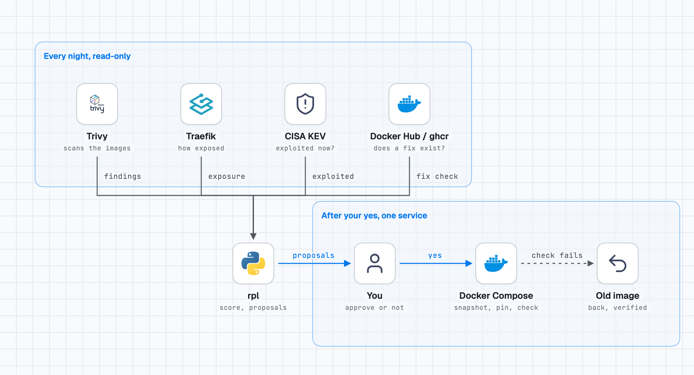

# risk-patch-loop

[](https://github.com/renocz/risk-patch-loop/actions/workflows/tests.yml)

**English** · [Français](README.fr.md)

**Which container vulnerabilities actually matter on *your* host, is there a fix that really removes them, and can it be applied safely, with a human saying yes?**

In one minute:
- A scanner gives you a list. On the author's homelab, one night's scan returned 2,297 fixable HIGH/CRITICAL findings. That is not a to-do list.
- rpl ranks them by how exposed each container really is, checks that a newer image really removes the finding (scanned from the registry, nothing pulled), and prepares proposals.
- Applying one is a separate command that touches **one service at a time**: snapshot, database dump, pinned image, dry run, recreate, health and route check, and a verified automatic rollback if the check fails.
- Nothing happens without a human: the tool prepares, you decide.

It is a proof of concept built and used for a week on one Docker host, with its limits [written down, not hidden](#known-limits). It is for someone who is comfortable reading 1,000 lines of Python, not a product.

## The loop in one picture

Every night, read-only: rpl reads four things a scanner alone does not combine. After your yes, one service is updated, and if the check fails the old image comes back.

<picture>
  <source media="(prefers-color-scheme: dark)" srcset="docs/loop-dark.png">
  
</picture>

```
scan ──► inventory ──► risk score ──► fix check ──► proposals ──► you say yes ──► patch + automatic rollback
```

- **Exposure-aware score.** Severity, "exploited in the wild" (CISA KEV), access to the Docker socket, and the role of the service, all scaled by how reachable the container is: on the Internet without a login, behind a login, on a LAN port, localhost only, internal.
- **A fix is proven before it is proposed.** The candidate version is scanned *from the registry* (nothing is pulled). If the maintainer has not published a rebuilt image, the answer is "no fix", not a version bump that changes nothing.
- **One service at a time.** Snapshot, database dump, pinned image, dry run, recreate, health and route check, and an automatic rollback if the check fails. A VPN container and the services behind it are never patched one by one: they form a group, patched as a whole by `rpl group` (new, tested on fakes and once on a sandbox Docker, never on a real VPN).
- **Nothing happens without a human.** The tool prepares proposals; applying one is a separate, explicit command.

## Start here: pick your path

- **I run Docker Compose behind Traefik and want to try it:** the [quick start](#quick-start), then the [files you write by hand](#files-you-write-by-hand-see-examples).
- **I run or manage infrastructure and want the short version:** [docs/for-it-leaders.md](docs/for-it-leaders.md), five minutes, no code ([version française](docs/fr/pour-les-dirigeants-it.md)).
- **I have questions** (how it differs from Trivy, Renovate or Watchtower, the rollback, what leaves the machine): the [FAQ](docs/faq.md) ([en français](docs/fr/faq.md)).
- **I want to know what to trust:** [known limits](#known-limits), then [docs/results.md](docs/results.md): what was measured, what was not, and the defects the tool had when it was first used on a real host.
- **I want to see how it decides:** [docs/design.md](docs/design.md) (the loop, the decisions, the limits).
- **An AI agent drives my infrastructure:** give it the read-only steps and keep `--apply` behind an approval it cannot grant itself, see [With an AI agent](#with-an-ai-agent).

## Status: v0.9, one host, honest numbers

Built and used for one week on one Docker host (65 containers, Traefik, one owner). **Read [docs/results.md](docs/results.md) before trusting it**: the score is **not validated**. It agrees with its owner's verdicts 14 times out of 20, but a trivial "always defer" answer gets 13, so this shows no added value yet; the roles were also tuned after seeing those verdicts. The automatic rollback has never fired on a real service. It handles Docker Compose + Traefik, Docker Hub and ghcr.io.

Tested: 502 automated tests against a fake Docker host (sequencing and refusals), run in CI on Python 3.9 and 3.12; a few behaviours were also checked by hand on real Docker (see the limits below).

## Known limits

From [docs/results.md](docs/results.md); none of these is hidden, and none is fixed yet.

- **One host.** Everything was measured on one homelab (65 containers, one owner, one week). No second host has run it.
- **Traefik only.** Exposure comes from Traefik labels. Another reverse proxy, or routes defined in a file, will read as "not routed".
- **Docker Hub and ghcr.io only.** Any other registry gives "UNKNOWN", never a guess.
- **The automatic rollback has never fired on its own on a real failure.** It was exercised on purpose, with failures injected: three times on a disposable service (2 November 2026), then three times on a real service of a real Docker host (14 November 2026, a small stateless web page): a route answering an unexpected status while the container is healthy, a container that never becomes healthy, and a `docker compose up` whose new container cannot start. Each time the old image came back (same image ID), the route answered again, the compose file was restored and the journal said `rollback ok`. That does not prove an application with a database, a real port conflict, or a failure nobody provoked. Treat it as tested, not as proven.
- **The automated tests do not run real Docker, Compose, Trivy or a real registry.** They prove the sequencing and the refusals against a fake host. A few behaviours were checked by hand, once, against Docker 29.9.2 and Compose v5.6.1 (see [docs/results.md](docs/results.md)); other versions are not covered, and CI does not repeat those checks.
- **The score is not validated.** It is a ranking, not a verdict. It agrees with its owner 14 times out of 20 (the trivial "always defer" answer: 13), on twenty cases, with roles chosen after seeing the verdicts: this does not show that it adds value. No false-negative rate and no precision have been measured.
- **The Docker socket is root.** `rpl patch` drives `docker` and `docker compose`; whoever can run it can become root on that host. Run it only as an account you would trust with root, keep `--apply` behind an approval the caller cannot grant itself, and do not expose it to untrusted input.
- **Data migrations are not covered.** An image rollback does not undo what a new version did to its database; the dump and the snapshot are the only way back, and `rpl` does not test a restore. Check you can restore before relying on it.
- **Update groups: one by one they are refused; as a whole, `rpl group` is new and unproven.** A container that shares another container's network (`network_mode: service:X` or `container:X`), and the container whose network it shares, form a group (`rpl/groups.py`). `rpl patch` and `rpl proposals` refuse every member, whatever its name (the name "gluetun" is still refused as a safety net); they look in the compose file and in Docker itself (every container, stopped ones included), and refuse when Docker cannot answer. `rpl group` patches the whole group, parent first, every dependant recreated after it, with a backup of the configuration directories and a rollback. **It has never run on a real VPN group or on a real application**: 65 tests against a model of Docker, runs on a sandbox Docker, and one supervised trial on the author's host on a disposable test group of `alpine` and `busybox` containers (22 November 2026: one full apply, and two applies killed with SIGTERM then rolled back by `--resume`; `docs/results.md`). Treat it as untested on your host until you have run `--plan` and a first apply while watching.
- **A group that is not exposed is almost never patched, by design.** `rpl group` only acts on a proven fix for a finding the score ranks ACT (45 or more), and the score is scaled by exposure: a container with no published port and no route is "internal" (factor 0.2) and cannot score above 22, whatever the vulnerability; on a LAN port (0.55) a fixable CRITICAL alone scores 22. A VPN container reachable only from the LAN will therefore stay untouched most of the time, and that silence is the ranking working, not a fault. The trial group had to declare an Internet exposure to be eligible.
- **The pause switch and the shared lock are a safety catch, not an access control.** `rpl pause on` stops every later `rpl patch` and `rpl proposals --apply` (exit code 5), and one lock file keeps two runs from applying at once. Both live in the state directory: two runners with different `state_dir` values do not see each other, and whoever can write that directory can remove them. A run that already started is not interrupted by the switch. A second run does not wait, it is refused. The lock is a `flock`: Unix only (without it nothing is applied), tested on Linux on a local file system, not on NFS or macOS, and never with two real updates competing on a real Docker host. Read-only commands and `--dry` ignore both.
- **Healthy-but-broken updates pass.** The check proves the container is healthy, runs the new image, and one route answers; it does not prove the application works.
- **The rollback restores the image, not the data.** A database migration run by the new version is not undone; only the dump or the snapshot can do that.
- **Pulled images are not verified.** The tool trusts the tag and the registry: no signature check (cosign or similar), and for a moving tag only the digest the registry reports at that moment is pinned. A compromised registry or maintainer is outside what it can detect.
- **What `rpl group` does not cover.** Group detection reads the network mode, not what the container does: a container that reaches the same peers some other way (a published port, a sidecar without `network_mode`) is not a group. A group must live in ONE compose file: if Docker knows a dependant the file does not name, the apply is refused. Only bind mounts located under the compose file's directory are backed up and restored; named volumes, bind mounts elsewhere and databases in other containers are not. The copy is taken with the members stopped (`quiesce: stop`, the default for a member that mounts a configuration directory), which is the only consistency guarantee: no SQLite or LevelDB tool is run. A member whose restore fails is left stopped, loudly (exit code 4). An application that changes data outside its configuration directory is not rolled back. Backups contain secrets: they are owner-only (mode 0700), kept 7 days by default, deleted by `rpl group --purge`, and nothing deletes them for you. The purge never deletes the backup of an apply that did not finish or whose rollback failed: that one waits for you. The fix proof is bound to a digest only for the group apply: `rpl patch` and `rpl proposals` still pin a versioned tag without one.
- **Notifications are new and unproven on a real host.** `rpl watch` reads only `group-journal.json` and reports an entry with no result after a grace period (60 minutes by default, `group_unfinished_grace_minutes`): an interrupted apply is announced after that delay, an apply that really runs longer gives a false alarm, and it reports the record, not the real state of the services. It is the only warning for a process stopped by SIGTERM, so it must run from a timer of its own; if that timer is dead nothing warns you. `rpl watch` must run as the account that runs `rpl group`: the journal is mode 0600, and under another account it exits 2 (`PermissionError`) instead of reporting. A failed delivery is retried after 30 s, then 60 s, doubling up to one hour, at most `max_attempts` times (with the defaults the tries span about 13 hours for a timer every minute and about 20 hours for an hourly timer; simulated with an injected clock, not on a real timer); `Retry-After` is not read and a hanging channel holds a run for its 15 s timeout, per channel and per event. `rpl notify` reads the state files, not Docker: the "nightly run missing or failed" events only work if the nightly job ends with `rpl notify --record ok|failed` (a job that forgets looks like a missing run); the first run records the containers present as a baseline without announcing them; patch results older than 72 hours are not replayed; findings accepted by hand are not reported as exclusions; a delivery means the service answered 2xx, not that someone read it; two runs at the same instant share `notifs.json` without a lock and can both send. Tested with doubles, then once on 23 November 2026 on the author's host with a receiver on the loopback interface, two SIGTERM-killed applies and a system timer running as root (`docs/results.md`): never against a real Telegram or remote webhook, never as a non-root account, never for days. That trial also found that the group apply's own "rolled back" message was sent once per plan and then never again; it is now sent once per apply (tests with doubles, not run again on a real host).

## Roadmap to 1.0

1.0 is released when two things are true, each with evidence in `docs/results.md`. The numbers are the author's own targets, open to argument in an issue. 1.0 does not mean "validated everywhere": it will still have run on one host only, the Docker socket stays root-equivalent, and the score has the limits listed above.

1. **Rollback exercised on a real service.** Done on 14 November 2026: three automatic rollbacks (a route answering an unexpected status, a container that never becomes healthy, a `docker compose up` that fails) on a real service, with failures injected on purpose, each journaled `rollback ok` with the original image back. A restore from a snapshot does not count. Logs and limits are in `docs/results.md`.
2. **A measured false-negative rate, published as it comes out.** A labelled sample of findings (100 when the host has that many), drawn at random with a published seed after the roles and thresholds are frozen (not the 20 cases used for tuning), labelled blind on the written criteria in [docs/labelling-criteria.md](docs/labelling-criteria.md) by the author and by a panel of language models from at least 3 families (the panel's majority counts as ONE reviewer, a model outside the panel breaks ties). Publish how many "act" verdicts the score ranks below ACT with a confidence interval, the precision next to the trivial "always defer" baseline, and the confusion matrix, whatever the result. Target: at most 10% of "act" verdicts missed; if it is missed, the score changes and the measurement is repeated. It is published as "1 human + 1 model panel, one host": weaker than two humans on several hosts, and written as such. With few "act" verdicts the interval is wide, and the text says so.

After 1.0 (1.1 and later): 4 weeks on an independent second host run by someone else, a human second reviewer, and a reverse proxy other than Traefik. Testers are expected to come with the announcement of 1.0.

## Quick start

Python 3.9 or later, no dependencies. Docker with the Compose plugin; Trivy runs as a container.

```bash
git clone https://github.com/renocz/risk-patch-loop && cd risk-patch-loop
cp examples/rpl.json rpl.json            # edit: state_dir, snapshot_command, files below
cp examples/roles.json examples/patch-apps.json .   # describe YOUR services
export RPL_CONFIG=$PWD/rpl.json

python -m rpl scan         # Trivy on running images + CISA KEV  -> findings.json
python -m rpl inventory    # how exposed is each container       -> inventory.json
python -m rpl risk         # score and ACT / PLAN / WATCH
python -m rpl fixcheck     # which candidate versions really fix the ACT rows (read-only)
python -m rpl proposals    # updates ready to approve
python -m rpl proposals --list
python -m rpl proposals --apply myapp --dry      # then without --dry
```

`rpl patch` is the last step on its own (`rpl patch --help`). Run the first five steps nightly (cron or a systemd timer).

Two commands run from timers of their own, not from the nightly job (limits in "Known limits"):

```bash
python -m rpl watch                      # every few minutes: a group apply that never recorded a result (exit 1; 2 if the journal is unreadable)
python -m rpl notify                     # hourly: collect events and deliver them (rpl/notify.py channels in rpl.json)
python -m rpl notify --record ok         # the LAST line of the nightly job (or: --record failed --reason "...")
```

`python -m rpl pause on --reason "..."` stops anything from being applied until `python -m rpl pause off` (`pause status` exits 1 while paused); `touch <state_dir>/PAUSED` does the same without Python.

A group (for example a VPN container and the services behind it) is declared in `rpl.json` under the parent's **container** name, then planned and applied:

```json
"groups": {"proj-vpn-1": {"policy": "ask", "reason": "VPN: recreating it cuts every service behind it", "confirmed": true,
                          "controls": ["members_healthy", "exit_differs", "no_leak"],
                          "services": {"indexer": {"quiesce": "none"}}}}
```

```bash
python -m rpl group --compose /srv/proj/compose.yaml --parent vpn --plan       # changes nothing; prints the plan and its fingerprint
python -m rpl group --compose /srv/proj/compose.yaml --parent vpn --approve <fingerprint>
python -m rpl group --compose /srv/proj/compose.yaml --parent vpn --resume     # after an interruption: roll back
python -m rpl group --purge                                                    # delete group backups older than 7 days
```

| Policy | Who starts the apply | What it needs |
|---|---|---|
| `auto` | the nightly run, no human | `confirmed: true` |
| `ask` (default to choose) | a human, at the command line | `confirmed: true`, a reason, and `--approve <fingerprint>` |
| `never` | nobody | a reason; always refused |

## Files you write by hand (see `examples/`)

| File | Purpose |
|---|---|
| `rpl.json` | paths, the snapshot command, the Traefik middleware words that mean "login required" |
| `patch-apps.json` | the services the tool is allowed to *propose*, each with a health route and a database to dump |
| `roles.json` | control-plane services and services that parse untrusted input (they weigh more) |
| `tunnel-hosts.json` | host names published to the Internet (from your tunnel or firewall); without it, Internet exposure is "unknown", never guessed |
| `accepted.json` | findings you reviewed and accepted: `{"image|CVE-...": "reason"}` |

## Safety rules, as code

- A scan that cannot do its job (stale database, KEV list unavailable, an image not analysed) is not "OK", and findings are not rewritten.
- `rpl patch` refuses to start without a snapshot command, unless you say `--no-snapshot`; a failed snapshot or database dump stops everything before any change.
- The dry run must show exactly one recreation, that of the service's own container; anything else (none, two, another service, unreadable output) stops everything and restores the compose file.
- A service sharing another container's network, or whose network others share (an update group, for example a VPN container and what runs behind it), is refused by `rpl patch`, which asks both the compose file and Docker (all containers, stopped ones included, under the shared lock); when Docker cannot answer, it refuses.
- `rpl group` applies a group only when a member has a proven security fix pending, and only under its policy: `auto` (the nightly run, no human), `ask` (the default: a human gives `--approve <fingerprint of the plan>`), `never`. `auto` and `ask` also need `"confirmed": true`; `ask` and `never` need a reason. The most restrictive of the group's and its services' policies wins. The fingerprint covers every member, the image it runs and the new reference pinned by digest; the digest must be the one the fix check scanned and the one the registry serves now, otherwise the answer is UNKNOWN and nothing is applied. The plan is computed again under the lock, so an approval given before a tag moved is refused.
- A group that could not be restored (a symlink leaving a configuration directory, a special file, files of another owner, more than `group_backup_max_mb`) is refused before anything changes. A journal entry is written before anything is stopped; after an interruption every group apply is refused until `rpl group ... --resume` has rolled back.
- Before it runs a single command, `rpl patch` checks the pause switch, takes the shared lock, and checks the switch again under the lock; it keeps the lock until the end, rollback included. Paused, or another run holding the lock: exit code 5, nothing touched. A switch that cannot be read counts as paused; a lock that cannot be taken means nothing is applied (`rpl/gate.py`).
- `rpl proposals --apply` takes the parameters from the stored proposal, nothing free-form, and refuses a proposal older than 36 hours, or whose file was modified after it was computed (SHA-256 check: integrity, not authentication).
- `rpl patch` validates service, database and image names before running anything, and refuses a service the Compose file does not define. A failed `docker compose up` or a failed dry run counts as a failed update, not as success. The pin is bound to the requested service: the image Compose resolves for it must equal `--old`, and the edited line must lie inside its block. `--route` and `--codes` are validated.
- After an update the container must run the new image; after a rollback it must run the original reference with the same image ID, otherwise the result is `rollback FAILED: CHECK BY HAND` (exit code 4; 2 means a verified rollback).

## With an AI agent

If an agent drives your infrastructure, give it the read-only steps and keep `--apply` behind an approval it cannot grant itself. [agent-ops-guardrails](https://github.com/renocz/agent-ops-guardrails) is the author's attempt at that approval step; this project works without it.

## Documentation

- [SECURITY.md](SECURITY.md): reporting a vulnerability, what the tool does and does not do
- [CONTRIBUTING.md](CONTRIBUTING.md): running the tests and the rules (standard library only, real numbers and written limits)
- [docs/faq.md](docs/faq.md): the questions I expect, with numbers in the answers
- [docs/for-it-leaders.md](docs/for-it-leaders.md): the short version for someone who manages infrastructure
- [docs/design.md](docs/design.md): the loop, the decisions, the limits
- [docs/results.md](docs/results.md): what was measured, what was not, the defects found by using it

## License

MIT. Use it, fork it, tell me what breaks.
