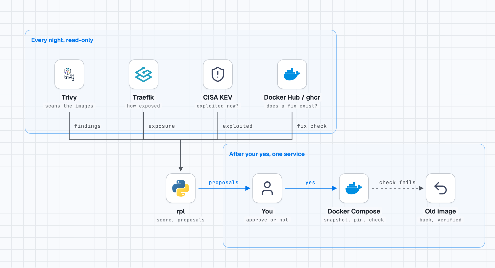

# risk-patch-loop

[](https://github.com/renocz/risk-patch-loop/actions/workflows/tests.yml)

**English** · [Français](README.fr.md)

**Which container vulnerabilities actually matter on *your* host, is there a fix that really removes them, and can it be applied safely, with a human saying yes?**

In one minute:
- A scanner gives you a list. On the author's homelab, one night's scan returned 2,297 fixable HIGH/CRITICAL findings. That is not a to-do list.
- rpl ranks them by how exposed each container really is, checks that a newer image really removes the finding (scanned from the registry, nothing pulled), and prepares proposals.
- Applying one is a separate command that touches **one service at a time**: snapshot, database dump, pinned image, dry run, recreate, health and route check, and a verified automatic rollback if the check fails.
- Nothing happens without a human: the tool prepares, you decide.

It is a proof of concept built and used for a week on one Docker host, with its limits [written down, not hidden](#known-limits). It is for someone who is comfortable reading 1,000 lines of Python, not a product.

## The loop in one picture

Every night, read-only: rpl reads four things a scanner alone does not combine. After your yes, one service is updated, and if the check fails the old image comes back.

<picture>
  <source media="(prefers-color-scheme: dark)" srcset="docs/loop-dark.png">
  
</picture>

```
scan ──► inventory ──► risk score ──► fix check ──► proposals ──► you say yes ──► patch + automatic rollback
```

- **Exposure-aware score.** Severity, "exploited in the wild" (CISA KEV), access to the Docker socket, and the role of the service, all scaled by how reachable the container is: on the Internet without a login, behind a login, on a LAN port, localhost only, internal.
- **A fix is proven before it is proposed.** The candidate version is scanned *from the registry* (nothing is pulled). If the maintainer has not published a rebuilt image, the answer is "no fix", not a version bump that changes nothing.
- **One service at a time.** Snapshot, database dump, pinned image, dry run, recreate, health and route check, and an automatic rollback if the check fails. A VPN container and the services behind it are refused.
- **Nothing happens without a human.** The tool prepares proposals; applying one is a separate, explicit command.

## Start here: pick your path

- **I run Docker Compose behind Traefik and want to try it:** the [quick start](#quick-start), then the [files you write by hand](#files-you-write-by-hand-see-examples).
- **I run or manage infrastructure and want the short version:** [docs/for-it-leaders.md](docs/for-it-leaders.md), five minutes, no code ([version française](docs/fr/pour-les-dirigeants-it.md)).
- **I have questions** (how it differs from Trivy, Renovate or Watchtower, the rollback, what leaves the machine): the [FAQ](docs/faq.md) ([en français](docs/fr/faq.md)).
- **I want to know what to trust:** [known limits](#known-limits), then [docs/results.md](docs/results.md): what was measured, what was not, and the defects the tool had when it was first used on a real host.
- **I want to see how it decides:** [docs/design.md](docs/design.md) (the loop, the decisions, the limits).
- **An AI agent drives my infrastructure:** give it the read-only steps and keep `--apply` behind an approval it cannot grant itself, see [With an AI agent](#with-an-ai-agent).

## Status: v0.9, one host, honest numbers

Built and used for one week on one Docker host (65 containers, Traefik, one owner). **Read [docs/results.md](docs/results.md) before trusting it**: the score agrees with its owner's verdicts 14 times out of 20 (a trivial "always defer" answer gets 13), the roles were tuned after seeing those verdicts, and the automatic rollback has never fired on a real service. It handles Docker Compose + Traefik, Docker Hub and ghcr.io.

Tested: 203 automated tests against a fake Docker host (sequencing and refusals), run in CI on Python 3.9 and 3.12; a few behaviours were also checked by hand on real Docker (see the limits below).

## Known limits

From [docs/results.md](docs/results.md); none of these is hidden, and none is fixed yet.

- **One host.** Everything was measured on one homelab (65 containers, one owner, one week). No second host has run it.
- **Traefik only.** Exposure comes from Traefik labels. Another reverse proxy, or routes defined in a file, will read as "not routed".
- **Docker Hub and ghcr.io only.** Any other registry gives "UNKNOWN", never a guess.
- **The automatic rollback has never fired on a real service.** It was exercised three times on purpose (2 November 2026) on a disposable service of a real Docker host: a new image that serves nothing, one that never becomes healthy, and a `docker compose up` whose new container cannot start. Each time the old image came back (same image ID), the route answered again, the compose file was restored and the journal said `rollback ok`. That does not prove a real application, a real port conflict, or the 1.0 criterion of three rollbacks on a real host. Treat it as tested, not as proven.
- **The automated tests do not run real Docker, Compose, Trivy or a real registry.** They prove the sequencing and the refusals against a fake host. A few behaviours were checked by hand, once, against Docker 29.9.2 and Compose v5.6.1 (see [docs/results.md](docs/results.md)); other versions are not covered, and CI does not repeat those checks.
- **The score is a ranking, not a verdict.** It agrees with its owner 14 times out of 20 (the trivial "always defer" answer: 13), on twenty cases, with roles chosen after seeing the verdicts. No false-negative rate has been measured.
- **Healthy-but-broken updates pass.** The check proves the container is healthy, runs the new image, and one route answers; it does not prove the application works.
- **The rollback restores the image, not the data.** A database migration run by the new version is not undone; only the dump or the snapshot can do that.
- **Pulled images are not verified.** The tool trusts the tag and the registry: no signature check (cosign or similar), and for a moving tag only the digest the registry reports at that moment is pinned. A compromised registry or maintainer is outside what it can detect.
- **VPN containers are recognised by name** ("gluetun"), not by what they do.

## Roadmap to 1.0

1.0 is released when all three are true, and each has evidence in `docs/results.md`. The numbers are proposed targets, open to argument in an issue.

1. **Rollback exercised in real conditions.** At least 3 automatic rollbacks on a real host, covering a container that never becomes healthy, a route that answers an unexpected status, and a `docker compose up` that fails; each journaled `rollback ok`, with the old image running and its route answering afterwards. Logs published.
2. **A second host.** At least 4 consecutive weeks on a second, independent host (a different owner, or a reverse proxy other than Traefik) with 20 or more containers, reported in the same format as the first host's numbers.
3. **A measured false-negative rate.** A labelled sample of at least 100 findings, with verdicts from at least 2 reviewers, drawn after the roles and thresholds are frozen (not the 20 cases used for tuning). Publish how many "act" verdicts the score ranks below ACT, with a confidence interval. Target: at most 10% of "act" verdicts missed. If the target is not met, the score changes and the measurement is repeated before 1.0.
   - *Ground truth:* a finding "deserved ACT" when at least 2 reviewers independently answer "act" on written criteria fixed **before** labelling: exploitable from where the container is exposed (exposure level from the inventory, not guessed), a fix exists, and the vulnerable component is reachable in this service. Disagreements are resolved by a third reviewer and reported, not hidden. Reviewers do not see the score.
   - *Denominator:* the "act" verdicts of that labelled sample, drawn at random (fixed seed, published) from all findings of at least 2 hosts' scans, stratified so that findings the score ranked WATCH or PLAN are as numerous as those it ranked ACT; the rate is "act verdicts ranked below ACT" / "act verdicts", with the count of both numbers shown, not only the percentage.

## Quick start

Python 3.9 or later, no dependencies. Docker with the Compose plugin; Trivy runs as a container.

```bash
git clone https://github.com/renocz/risk-patch-loop && cd risk-patch-loop
cp examples/rpl.json rpl.json            # edit: state_dir, snapshot_command, files below
cp examples/roles.json examples/patch-apps.json .   # describe YOUR services
export RPL_CONFIG=$PWD/rpl.json

python -m rpl scan         # Trivy on running images + CISA KEV  -> findings.json
python -m rpl inventory    # how exposed is each container       -> inventory.json
python -m rpl risk         # score and ACT / PLAN / WATCH
python -m rpl fixcheck     # which candidate versions really fix the ACT rows (read-only)
python -m rpl proposals    # updates ready to approve
python -m rpl proposals --list
python -m rpl proposals --apply myapp --dry      # then without --dry
```

`rpl patch` is the last step on its own (`rpl patch --help`). Run the first five steps nightly (cron or a systemd timer).

## Files you write by hand (see `examples/`)

| File | Purpose |
|---|---|
| `rpl.json` | paths, the snapshot command, the Traefik middleware words that mean "login required" |
| `patch-apps.json` | the services the tool is allowed to *propose*, each with a health route and a database to dump |
| `roles.json` | control-plane services and services that parse untrusted input (they weigh more) |
| `tunnel-hosts.json` | host names published to the Internet (from your tunnel or firewall); without it, Internet exposure is "unknown", never guessed |
| `accepted.json` | findings you reviewed and accepted: `{"image|CVE-...": "reason"}` |

## Safety rules, as code

- A scan that cannot do its job (stale database, KEV list unavailable, an image not analysed) is not "OK", and findings are not rewritten.
- `rpl patch` refuses to start without a snapshot command, unless you say `--no-snapshot`; a failed snapshot or database dump stops everything before any change.
- The dry run must show exactly one recreation, that of the service's own container; anything else (none, two, another service, unreadable output) stops everything and restores the compose file.
- A VPN container, or a service sharing its network, is refused.
- `rpl proposals --apply` takes the parameters from the stored proposal, nothing free-form, and refuses a proposal older than 36 hours, or whose file was modified after it was computed (SHA-256 check: integrity, not authentication).
- `rpl patch` validates service, database and image names before running anything, and refuses a service the Compose file does not define. A failed `docker compose up` or a failed dry run counts as a failed update, not as success. The pin is bound to the requested service: the image Compose resolves for it must equal `--old`, and the edited line must lie inside its block. `--route` and `--codes` are validated.
- After an update the container must run the new image; after a rollback it must run the original reference with the same image ID, otherwise the result is `rollback FAILED: CHECK BY HAND` (exit code 4; 2 means a verified rollback).

## With an AI agent

If an agent drives your infrastructure, give it the read-only steps and keep `--apply` behind an approval it cannot grant itself. [agent-ops-guardrails](https://github.com/renocz/agent-ops-guardrails) is the author's attempt at that approval step; this project works without it.

## Documentation

- [SECURITY.md](SECURITY.md): reporting a vulnerability, what the tool does and does not do
- [CONTRIBUTING.md](CONTRIBUTING.md): running the tests and the rules (standard library only, real numbers and written limits)
- [docs/faq.md](docs/faq.md): the questions I expect, with numbers in the answers
- [docs/for-it-leaders.md](docs/for-it-leaders.md): the short version for someone who manages infrastructure
- [docs/design.md](docs/design.md): the loop, the decisions, the limits
- [docs/results.md](docs/results.md): what was measured, what was not, the defects found by using it

## License

MIT. Use it, fork it, tell me what breaks.
