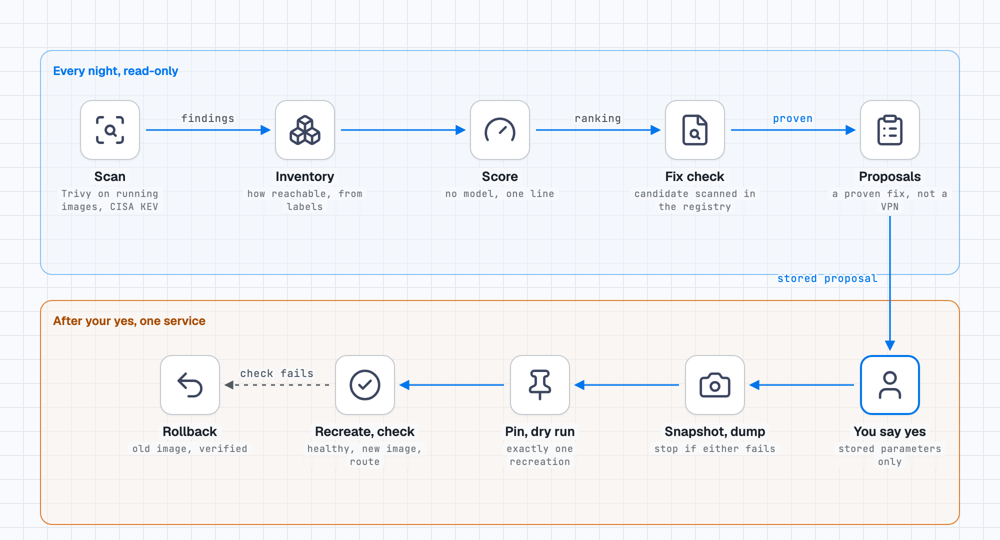

# Design

## The loop

```
scan ──► inventory ──► risk score ──► fix check ──► proposals ──► (a human says yes) ──► patch (with rollback)
 nightly    nightly        nightly        nightly       nightly                              one service at a time
```

<picture>
  <source media="(prefers-color-scheme: dark)" srcset="design-decisions-dark.png">
  
</picture>

1. **scan** (`rpl scan`): Trivy on the images that are running, plus the CISA KEV list. Three classes: A (HIGH/CRITICAL with a fix), B (KEV, exploited in the wild, any severity), C (no fix). A scan that could not do its job is never reported "OK".
2. **inventory** (`rpl inventory`): for each container, how exposed it really is, from `docker inspect` and Traefik labels: Internet with or without a forward-auth login, LAN port, LAN through the proxy, localhost, internal; plus Docker socket and elevated rights. Internet exposure is *unknown* until you provide the list of published host names (a tunnel configuration, a firewall rule export): it is never guessed.
3. **risk score** (`rpl risk`): `(severity + KEV + sensitive access + role) x exposure factor`. Readable in one line, no model, no network call. See the module docstring for the points.
4. **fix check** (`rpl fixcheck`): for images with "act" rows, read the registry, pick a candidate version, scan *the candidate from the registry*, and say whether it removes the findings: complete, partial, none, or no newer version.
5. **proposals** (`rpl proposals`): a service is proposed only if it has an "act" row, a *proven* fix, is described in `patch-apps.json`, and is not a VPN container or a service sharing its network. Everything else is listed with the reason.
6. **patch** (`rpl patch`, or `rpl proposals --apply <service>`): snapshot, database dump, pin the new image, dry run (only that service may be recreated), recreate, check (healthy + a route through the reverse proxy answers with an expected status), automatic rollback if the check fails.

## Decisions, and why

**Nothing is applied without a human saying yes.** `rpl proposals` prepares; `rpl proposals --apply <service>` runs exactly the parameters of a stored proposal (never a free argument, refused if older than 36 h). If you run an AI agent next to this, the safe arrangement is the one in [agent-ops-guardrails](https://github.com/renocz/agent-ops-guardrails): the agent may run the read-only steps freely, and the `--apply` step waits for an approval the agent cannot give itself.

**A fix is proven before it is proposed.** Bumping a tag changes nothing if the maintainer has not published a rebuilt image. In the author's first week, updating blindly would have changed nothing for 5 of 12 images (docs/results.md).

**Scan by image ID, not by name.** A container started from an image pinned by digest leaves the previous tag in the local store; scanning the tag reports the old image.

**Moving tags are pinned by digest.** `image: app:latest` becomes `image: app:latest@sha256:...`: the version in service is then known and repeatable.

**The rollback restores the image, not the data.** For a service with a PostgreSQL database, the dump (verified readable with `pg_restore -l`) and the snapshot are the safety net. Stateful migrations are the part the tool cannot undo.

**VPN containers are refused.** A service whose network namespace belongs to a VPN container is recreated only by hand: recreating the VPN container breaks the services behind it. The check is a name match ("gluetun" in the container or in `network_mode`); other VPN setups need a line added to `REFUSED_NAMES` in `rpl/patch.py`.

**Honest limits.** The route check proves one route answers. The score was tuned on one owner's twenty verdicts. The rollback has not been triggered in production. See `docs/results.md`.

## What it does not do

- It does not patch the host operating system, only container images.
- It does not run a vulnerability scan of source code or of images that are not running.
- It does not decide for you: a score orders work, it is not a verdict.
- It does not hide that a finding has no fix: those stay on the list as "WATCH (no fix)".
