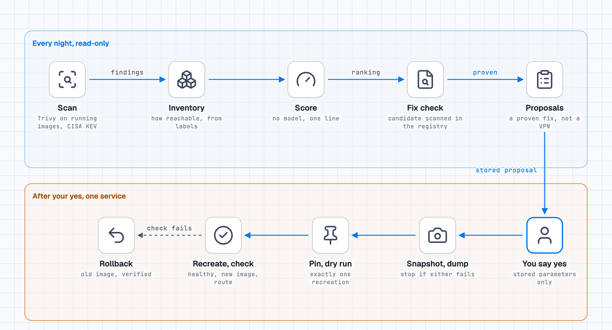

# Design

## The loop

```
scan ──► inventory ──► risk score ──► fix check ──► proposals ──► (a human says yes) ──► patch (with rollback)
 nightly    nightly        nightly        nightly       nightly                              one service at a time
```

<picture>
  <source media="(prefers-color-scheme: dark)" srcset="design-decisions-dark.png">
  
</picture>

1. **scan** (`rpl scan`): Trivy on the images that are running, plus the CISA KEV list. Three classes: A (HIGH/CRITICAL with a fix), B (KEV, exploited in the wild, any severity), C (no fix). A scan that could not do its job is never reported "OK".
2. **inventory** (`rpl inventory`): for each container, how exposed it really is, from `docker inspect` and Traefik labels: Internet with or without a forward-auth login, LAN port, LAN through the proxy, localhost, internal; plus Docker socket and elevated rights. Internet exposure is *unknown* until you provide the list of published host names (a tunnel configuration, a firewall rule export): it is never guessed.
3. **risk score** (`rpl risk`): `(severity + KEV + sensitive access + role) x exposure factor`. Readable in one line, no model, no network call. See the module docstring for the points.
4. **fix check** (`rpl fixcheck`): for images with "act" rows, read the registry, pick a candidate version, scan *the candidate from the registry*, and say whether it removes the findings: complete, partial, none, or no newer version.
5. **proposals** (`rpl proposals`): a service is proposed only if it has an "act" row, a *proven* fix, is described in `patch-apps.json`, and is not a member of an update group (those go through `rpl group`). Everything else is listed with the reason.
6. **patch** (`rpl patch`, or `rpl proposals --apply <service>`): snapshot, database dump, pin the new image, dry run (only that service may be recreated), recreate, check (healthy + a route through the reverse proxy answers with an expected status), automatic rollback if the check fails.

## Decisions, and why

**Nothing is applied without a human saying yes.** `rpl proposals` prepares; `rpl proposals --apply <service>` runs exactly the parameters of a stored proposal (never a free argument, refused if older than 36 h). If you run an AI agent next to this, the safe arrangement is the one in [agent-ops-guardrails](https://github.com/renocz/agent-ops-guardrails): the agent may run the read-only steps freely, and the `--apply` step waits for an approval the agent cannot give itself.

**A fix is proven before it is proposed.** Bumping a tag changes nothing if the maintainer has not published a rebuilt image. In the author's first week, updating blindly would have changed nothing for 5 of 12 images (docs/results.md).

**Scan by image ID, not by name.** A container started from an image pinned by digest leaves the previous tag in the local store; scanning the tag reports the old image.

**Moving tags are pinned by digest.** `image: app:latest` becomes `image: app:latest@sha256:...`: the version in service is then known and repeatable.

**The rollback restores the image, not the data.** For a service with a PostgreSQL database, the dump (verified readable with `pg_restore -l`) and the snapshot are the safety net. Stateful migrations are the part the tool cannot undo.

**Update groups are patched as a whole, never one by one.** A service whose network namespace belongs to another container, and that container, form a group: recreating the parent alone breaks the services behind it. `rpl/groups.py` describes these groups from `network_mode` (`service:X`, `container:X`). `rpl patch` refuses every member: it reads the compose file (a group whose containers do not exist yet) and then `docker inspect` of every container of the host, stopped ones included, under the shared lock; when Docker cannot be listed or inspected it refuses. `rpl proposals` reads `docker inspect` of every container too, and proposes only running ones outside any group. The name "gluetun" stays refused as a safety net in `REFUSED_NAMES` (`rpl/patch.py`).

**Group apply** (`rpl group`, `rpl/groupapply.py`). Only when a member has a proven fix pending. The policy table: `auto` is started by the nightly run without a human; `ask` needs a human who passes the fingerprint of the plan; `never` is refused; `auto` and `ask` both need `confirmed: true`; the most restrictive of the group's and its services' policies wins. Why a fingerprint: any tag can move between the moment a fix is proven, the moment a human reads the plan and the moment it runs. The fix check records the digest it scanned (the same before and after the scan, or nothing); the plan pins every new image to that digest, refuses when the registry serves another one or none can be read, and its fingerprint covers each member, the image ID it runs and the new reference. The apply computes the plan again under the lock and compares. Why every dependant is recreated: a dependant keeps the namespace of the parent container it was created against; after the parent is recreated that namespace is dead (checked on Docker 29.10.0: `NetworkMode` is `container:<ID>`). Members without a new image are recreated on the same reference and must come back with the same image ID. Why stop before copying: embedded databases (SQLite, LevelDB, BoltDB) are only consistent on disk when their process is stopped, and that is the only guarantee offered. Why a journal first: the entry is written before anything is stopped, so an interruption leaves a record that blocks every later group apply until `--resume` rolls back. Restore is per member and per directory (copied next to the live one, re-read, compared, then swapped in), never global; a member whose restore fails stays stopped rather than starting an old image on a configuration the new one changed. No group state file is kept: the group is read from Docker on every call, so the "recompute after 6 hours, distrust after 3 days" rule has nothing to apply to until something caches it.

**Notifications.** `rpl/notify.py` sends events to the channels of the `notifications` config. "Delivered" means every channel answered 2xx; anything else stays queued with its error and is retried up to a cap, so nothing disappears silently. Secrets live in owner-only files, never in the config or the state. The webhook checks the address it actually connects to (private, loopback, link-local refused by default) and follows no redirect. Only the library exists: no command yet gathers events from the other modules.

**Group rehearsal.** `rpl group --dry` (`rpl/group.py`) is the quick check and never changes anything (`--plan` is the full one): it checks that Docker's own dry run of a forced recreation touches exactly the group's containers, then runs the controls named in the config (`rpl/controls.py`, a closed list: members healthy, exit address differs from the host's, dependants exit like the parent). "Unknown" (an address could not be read) is never counted as passing. Limits: the exit-address controls need outbound access to `probe_url` and pull `probe_image`; `--dry` reads the members from the compose file only and looks the group up under the parent's service name, where `--plan` and the apply use Docker and the parent's container name.

**One switch, one lock.** Everything that applies goes through `gate.applying()` (`rpl/gate.py`). The pause switch is a file, `PAUSED`, in the state directory: if anything exists at that path nothing is applied, so `touch` is enough in an emergency, and a switch that cannot be read counts as paused. The lock is a non-blocking `flock` on `apply.lock`: a second run is refused at once (exit code 5, the same as paused: "not now, nothing touched") instead of queueing behind an update nobody is watching, and the kernel releases it when the process dies, so a crash leaves no stale lock to clean by hand. `rpl patch` takes it before its first check, the group refusal included, and keeps it through the rollback; the switch is read before the lock and again under it, never afterwards, because stopping between a recreation and its rollback is worse than finishing. `rpl proposals --apply` checks the switch and lets the `rpl patch` it starts hold the lock. Read-only steps and dry runs ignore both. Limits: both files are per state directory, they stop cooperating runners and not someone who can write that directory, and `flock` was only exercised on Linux on a local file system.

**Honest limits.** The route check proves one route answers. The score was tuned on one owner's twenty verdicts. The rollback has not been triggered in production. See `docs/results.md`.

## What it does not do

- It does not patch the host operating system, only container images.
- It does not run a vulnerability scan of source code or of images that are not running.
- It does not decide for you: a score orders work, it is not a verdict.
- It does not hide that a finding has no fix: those stay on the list as "WATCH (no fix)".
